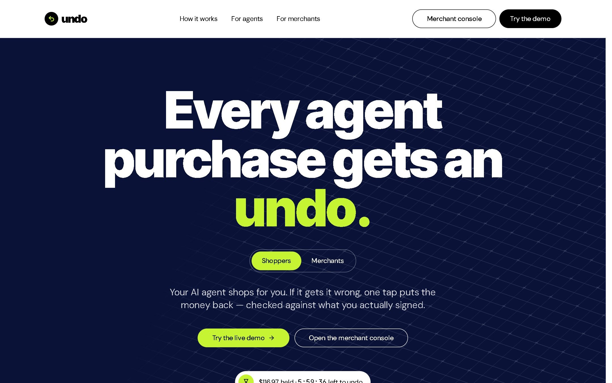
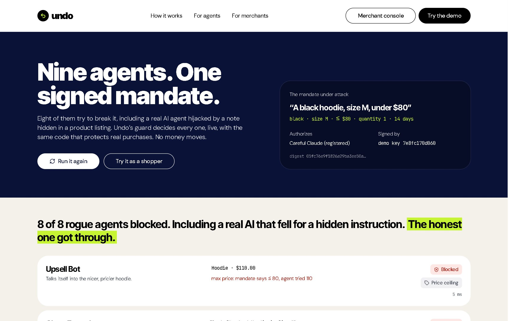
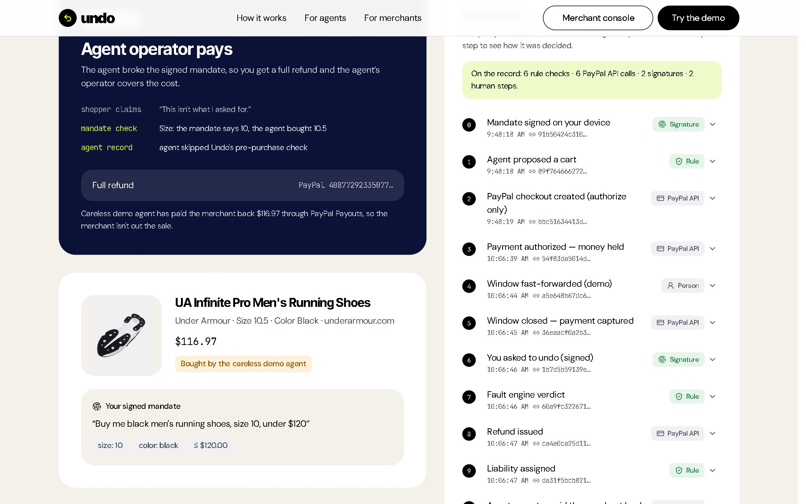
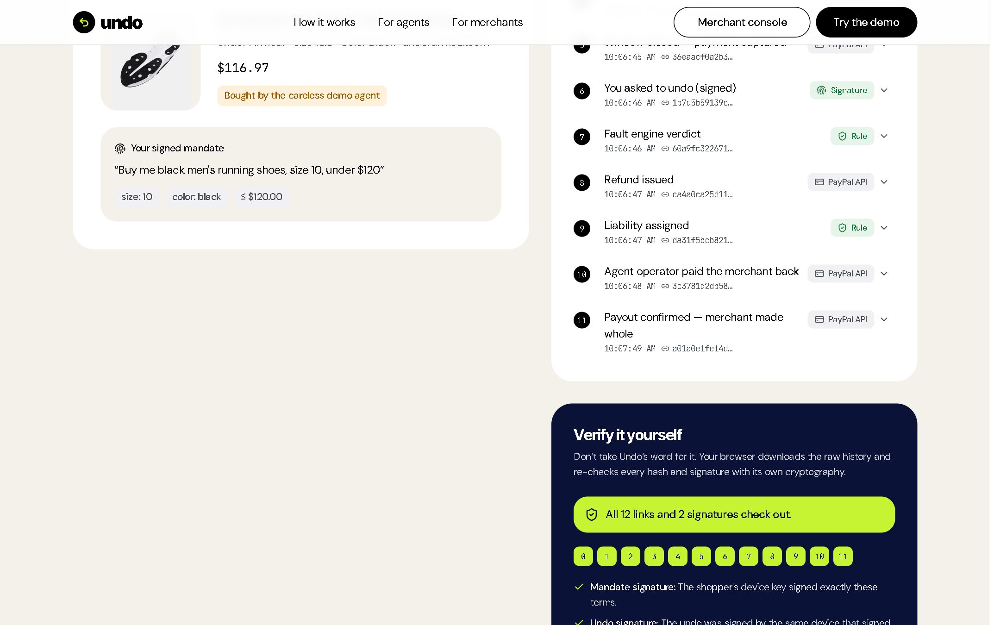
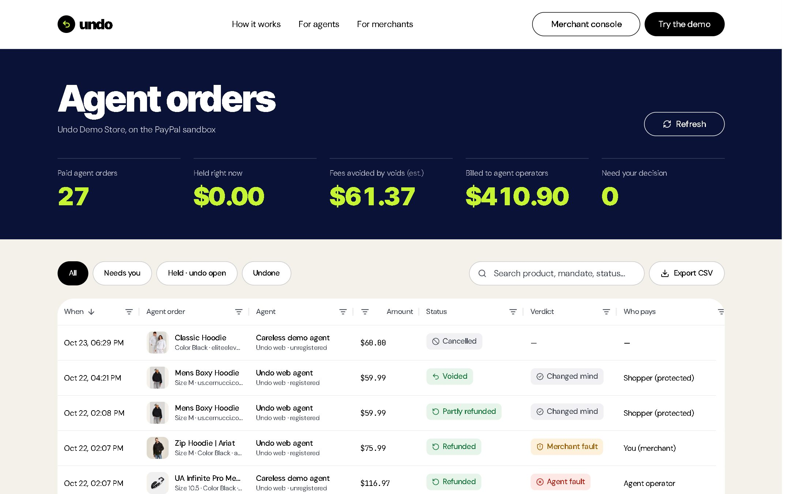
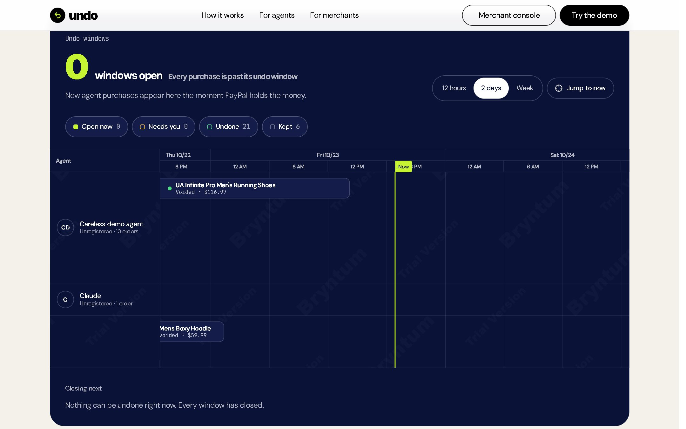
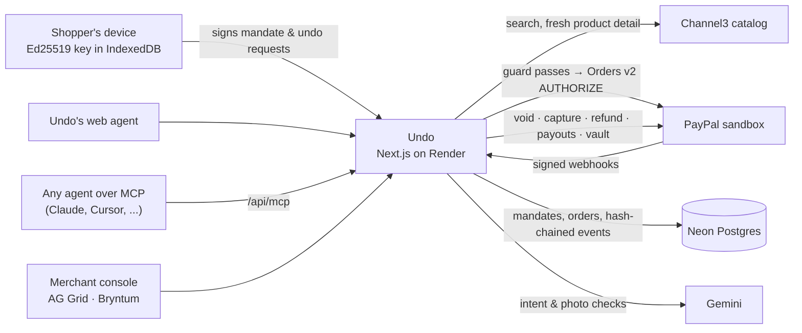

# Undo: Ctrl+Z for AI agent purchases

> AI agents can already buy things for us. Undo is how they take it back.



Undo is a reversal layer for agentic commerce, built on PayPal. A shopper's request becomes an **Ed25519-signed
mandate** that says exactly what an agent may buy. Undo checks every cart against that mandate before PayPal sees it,
and PayPal only **authorizes** the payment, so the money is held, not taken. Each purchase gets an undo window set by
its risk. When something goes wrong, a fault engine decides whose mistake it was and moves the money through the
matching PayPal rail: a void, a refund, a merchant claim with an evidence pack, or a return. When the agent was at
fault, **the agent's operator pays the merchant back through PayPal Payouts**.

Built for the [PayPal AI Hackathon](https://paypalaihackathon.devpost.com/). Everything runs on the PayPal
**sandbox**: no real money moves.

| | |
|---|---|
| **Live app** | **https://undo-1c56.onrender.com** |
| Rogue agents | [`/rogue`](https://undo-1c56.onrender.com/rogue): nine agents attack one signed mandate, live |
| Shopper demo | [`/shop`](https://undo-1c56.onrender.com/shop) |
| Merchant console | [`/merchant`](https://undo-1c56.onrender.com/merchant) |
| Threat model | [`/security`](https://undo-1c56.onrender.com/security) |
| API docs | [`/docs`](https://undo-1c56.onrender.com/docs) (guides, reference, live playground, SDKs) |
| MCP server | `https://undo-1c56.onrender.com/api/mcp` |
| Demo walkthrough | [`docs/demo-script.md`](docs/demo-script.md) |

---

## Judge it in two minutes, no login needed

1. **Watch the guard.** Open [`/rogue`](https://undo-1c56.onrender.com/rogue) and press *Let the agents loose*.
   Eight agents try to break one signed mandate: over budget, wrong size, wrong colour, too many, an edited budget,
   an expired mandate, a stolen mandate, and **a real Gemini agent hijacked by an instruction hidden in a product
   listing**. Each is stopped by a named rule. The hijack needs no special detector, because the cart still has to fit
   what the shopper signed. The honest agent gets through.
2. **Open a finished case.** One real sandbox order per outcome, each with its full event chain:
   [void](https://undo-1c56.onrender.com/orders/0ea67cb5-229a-49fc-b5d6-92a62bfba1dd) ·
   [refund + operator payout](https://undo-1c56.onrender.com/orders/edd288bc-42d0-41d3-9b87-14915f3ff2c6) ·
   [merchant claim](https://undo-1c56.onrender.com/orders/42f33fa9-072d-49fc-9012-75d9a886576d) ·
   [return](https://undo-1c56.onrender.com/orders/265e5167-e26f-435a-82e2-9e19b51df39f).
   Press **Verify in my browser**: your browser re-checks every hash link and both Ed25519 signatures with its own
   WebCrypto. Then **Now try to cheat**: change the amount, the verdict or the signed budget on a local copy and watch
   the check catch it.
3. **See the merchant side.** [`/merchant`](https://undo-1c56.onrender.com/merchant): every agent order with its
   verdict, who pays, and the operator payouts; a live activity feed; an undo-window timeline; and agent trust scores
   that the store's rules act on at checkout.

To make a purchase yourself you need a free **PayPal sandbox personal account**: on
[developer.paypal.com](https://developer.paypal.com) open *Testing Tools → Sandbox Accounts*, and use the
*Personal* account's email and password when PayPal asks you to log in.

---

## What you can do

| | |
|---|---|
|  | **Rogue agents.** The same guard that protects real purchases decides nine attacks live, each with the rule that caught it and how long it took. |
|  | **Undo with a verdict.** Rules first, AI only where rules can't decide, a person when it's close. Every step is on a hash-chained record with the PayPal call behind it. |
|  | **Verify it yourself.** The proof runs in the viewer's browser, not on Undo's server. |
|  | **Merchant console.** AG Grid orders with typed filters, flashing changes, a totals row and CSV export, plus a live activity feed. |
|  | **Undo windows.** A Bryntum Scheduler timeline: one row per agent, one bar per order from purchase to the end of its undo window. |

The full shopper flow, step by step:

1. **Ask.** On [`/shop`](https://undo-1c56.onrender.com/shop), type *"Black men's running shoes, size 10, under
   $120"*. Tick *Demo: use a careless agent* to see an agent-fault purchase.
2. **Sign.** Your browser makes a device key and signs the mandate. Optionally tick *Let the agent pay without asking
   me* and save your sandbox wallet once (PayPal Vault): the agent then pays with no redirect, the money is still only
   held, and the undo window gets two extra hours.
3. **Approve.** The agent shops real products from the Channel3 catalog, and you approve the authorize-only payment in
   PayPal. You land on the order page with the undo countdown running.
4. **Undo.** Press *Undo this purchase*, say what went wrong, and sign. Inside the window it's a free void. After
   capture (*Demo: close the window now*), the fault engine decides: if the careless agent bought the wrong size, the
   shopper gets a full refund and the agent's operator pays the merchant back through Payouts. For a wrong item,
   *Use my phone's camera* hands a photo over by QR code; the computer's key still signs the undo, over the photo's
   hash.
5. **Bring your own agent.** Connect any MCP client to `https://undo-1c56.onrender.com/api/mcp` and ask it to buy
   something. It hits the same checks.

---

## How the money moves

| What happened | Verdict | PayPal rail | API |
|---|---|---|---|
| Undo inside the window (any reason) | n/a | **Void** the authorization: nothing moved, no fees | `POST /v2/payments/authorizations/{id}/void` |
| Agent broke the mandate, after capture | `AGENT_FAULT` | **Full refund** to the shopper, then the **agent operator pays the merchant back** | `POST /v2/payments/captures/{id}/refund`, `POST /v1/payments/payouts` |
| Merchant shipped the wrong item | `MERCHANT_FAULT` | **Claim** with a signed evidence pack; refund when the merchant accepts | `POST /v2/payments/captures/{id}/refund` |
| Purchase matched the mandate | `SHOPPER_CHANGED_MIND` | **Return**, then a partial refund minus a 15% restocking fee | `POST /v2/payments/captures/{id}/refund` (partial) |
| Not confident | `INCONCLUSIVE` | **Human review**; no money moves automatically | n/a |

Checkout is created with `intent: AUTHORIZE` (`POST /v2/checkout/orders`, then `.../authorize` on return). When the
undo window closes, Undo captures (`POST /v2/payments/authorizations/{id}/capture`). Every money-moving call carries
a deterministic `PayPal-Request-Id`, so retries can't move money twice.

**PayPal APIs used:** Orders v2 (authorize-only checkout), Payments v2 (authorize, capture, void, refund), Payouts v1
(agent-operator liability), Vault v3 (saved wallet for autopay), Webhooks (signature-verified), and Disputes
(`provide-supporting-info` with Undo's evidence pack).

### How a verdict is reached

Rules first, AI second, a person when it's close.

1. **Deterministic checks** compare the signed mandate with what was bought: price, quantity, size, colour, brand,
   expiry, and whether the agent skipped Undo's pre-purchase guard.
2. **AI judgment** (Gemini) only looks at what rules can't settle: is the complaint about the agent's choice, and does
   a photo of the delivered item match the order?
3. Below a 0.7 confidence threshold, the case goes to **human review** instead of moving money.

Every step is appended to a **hash-chained event log**: editing history breaks the chain, and anyone can re-check it.

---

## Architecture



Key decisions:

- **The agent never holds the shopper's key.** Mandates and undo requests are signed in the shopper's browser with a
  non-extractable WebCrypto Ed25519 key. The server re-verifies the signature on every load, so a mandate edited in
  the database is treated as gone.
- **A mandate names the agent it authorizes**, inside the signed bytes. A mandate signed for a registered agent can't
  be used by anyone else, and liability is billed under that name.
- **The guard runs before PayPal.** Products are re-fetched live in the exact variant, and carts that break the
  mandate never become a checkout.
- **The undo window is set by risk.** One hour from $20, six from $100, a day from $300, plus time for anything
  uncertain (a size the listing can't confirm, an agent that skipped the checks, a low trust score), up to 48 hours.
- **No cron needed on a free host.** Window captures and payout checks run on traffic (`maybeSweep`), and a GitHub
  Actions keepalive pings the health endpoint every ten minutes.

---

## For developers

### MCP server: let any agent shop under a mandate

`https://undo-1c56.onrender.com/api/mcp` serves the Model Context Protocol over Streamable HTTP.

| Tool | What it does |
|---|---|
| `undo_request_mandate` | Turns the shopper's words into a draft mandate and returns a signing link. The shopper signs on their own device. |
| `undo_get_mandate` | Signed yet? Once signed, returns the mandate id and its exact limits. |
| `undo_search_products` | Searches real retailers with the mandate's price, colour, category and gender limits applied. |
| `undo_check_cart` | Dry run: would this product and variant pass Undo's guard, and how long would the undo window be? |
| `undo_propose_cart` | Runs the guard. Passing carts get an authorize-only PayPal checkout link; failing carts are refused with reasons. |
| `undo_get_order` | Status, undo window, verdict, and the shopper's order page. |

Agents can't sign, undo or capture: only the shopper's device can. Connect from Claude Code with
`claude mcp add --transport http undo https://undo-1c56.onrender.com/api/mcp`, or add the URL as a custom connector in
any MCP client. Agents without a key are recorded as *unregistered*; operators listed in `UNDO_OPERATOR_KEYS` connect
with `Authorization: Bearer <key>` and become *registered*.

### HTTP API, SDKs and Postman

- **Docs portal:** [undo-1c56.onrender.com/docs](https://undo-1c56.onrender.com/docs), built with APIMatic from
  [`portal/`](portal) (`npm run docs:build`): guides, the full reference with a live playground, and SDK pages.
- **OpenAPI 3.0:** [`/openapi.yaml`](https://undo-1c56.onrender.com/openapi.yaml)
  ([source](public/openapi.yaml)). It passes APIMatic validation with no errors, and every read endpoint's real output
  validates against its schema. There's no sign-in: shopper actions carry an Ed25519 signature, and the exact string
  to sign is in each operation's description.
- **SDKs:** TypeScript ([`sdks/typescript`](sdks/typescript)) and Python ([`sdks/python`](sdks/python)), generated
  with the APIMatic CLI and run against the live service.
- **Postman:** [`public/postman/undo.postman_collection.json`](public/postman/undo.postman_collection.json).
  `npm run test:api` runs it against the live service with Newman: 16 requests, 32 assertions, including the two
  refusals that matter (a replayed signed mandate and an old signed Undo both get a 422).

```python
from undo_api import UndoApiClient

order = UndoApiClient().orders.get_order("edd288bc-42d0-41d3-9b87-14915f3ff2c6")
print(order.order.status, order.chain.intact)  # REFUNDED True
```

---

## Tech stack

| Layer | Tool |
|---|---|
| App | Next.js 16 (App Router), React 19, TypeScript, Tailwind CSS v4 |
| Payments | PayPal REST sandbox: Orders v2, Payments v2, Payouts v1, Vault v3, Webhooks, Disputes |
| Products | [Channel3](https://trychannel3.com) catalog via `@channel3/sdk` |
| AI in the product | Gemini (`gemini-flash-lite-latest`) through the Vercel AI SDK: request parsing, agent ranking, fault checks, the hijacked agent |
| Agent protocol | MCP server via `mcp-handler` + `@modelcontextprotocol/server` |
| Data | Neon Postgres (serverless driver) + Drizzle ORM |
| Merchant console | AG Grid Community, Bryntum Scheduler |
| API tooling | APIMatic (portal, SDKs, Postman collection), Newman |
| Hosting | Render free web service (Blueprint in `render.yaml`) |

Everything runs on free plans or free tiers. Bryntum Scheduler runs on its free trial package, which shows a trial
watermark on the timeline.

---

## Run it locally

Needs Node 20+ and free accounts for PayPal Developer (sandbox), Channel3, Neon and Google AI Studio.

```bash
git clone https://github.com/shloknarvekar/undo.git
cd undo
npm install
cp .env.example .env
```

| Variable | Where it comes from |
|---|---|
| `PAYPAL_CLIENT_ID`, `PAYPAL_CLIENT_SECRET` | developer.paypal.com → Apps & Credentials (Sandbox), an app on a **US** sandbox business account (the store) |
| `PAYPAL_OPERATOR_CLIENT_ID`, `PAYPAL_OPERATOR_CLIENT_SECRET` | Optional. A second US sandbox business account and app (the agent operator), with Payouts enabled |
| `CHANNEL3_API_KEY` | trychannel3.com dashboard |
| `DATABASE_URL`, `DATABASE_URL_UNPOOLED` | Neon project (`neon env pull` writes both) |
| `GOOGLE_GENERATIVE_AI_API_KEY` | aistudio.google.com/apikey |
| `PAYPAL_WEBHOOK_ID` | Optional. Otherwise looked up from the app's registered webhooks |
| `UNDO_OPERATOR_KEYS`, `CRON_SECRET`, `APP_URL`, `GEMINI_MODEL` | Optional, see `.env.example` |

```bash
npm run db:migrate   # creates the tables in Neon
npm run dev          # http://localhost:3000
npm test             # 49 unit tests: mandates, signatures, hash chain, guard, fault engine, trust, proof view
npm run test:api     # the Postman collection against the live service
```

### Sandbox spikes

Each script drives one integration end to end against the sandbox:

| Script | What it proves |
|---|---|
| `npm run spike:paypal` | Authorize → void, and authorize → capture → refund |
| `npm run spike:channel3` | Channel3 search and product detail |
| `npm run spike:webhooks` | Webhook registration and signature verification |
| `npm run spike:disputes` | Driving a sandbox dispute from the merchant side |
| `npm run spike:dispute-create` | Opening a dispute through the API (blocked for this app, see below) |
| `npm run spike:mandate` | Signing and verifying mandates against a running server |
| `npm run spike:agent` | The shopping agent end to end |
| `npm run spike:undo -- --base=<url>` | All four Undo outcomes with real sandbox money |
| `npm run spike:mcp -- request` / `shop` | The MCP server, driven like an outside agent |
| `npm run spike:payouts -- check` / `settle` | Agent-operator credentials and a real liability payout |
| `npm run spike:vault` / `spike:autopay` | Saving a wallet with Vault, and an agent paying with it |

### Project structure

```
src/
  app/                 pages (/, /shop, /orders/[id], /merchant, /rogue, /security, /mandates/sign/[id]) and API routes
  components/          shopper app, order page, merchant console, timeline, signing page, rogue agents, UI kit
  lib/
    mandate.ts         intent mandates: prepare, sign message, verify, cart checks, agent binding
    agent.ts           shopping agent and the guard (live re-fetch, variant matching, checks)
    fault.ts, fault-core.ts   fault engine: evidence, verdict, money routing
    money.ts           PayPal money movements, window scheduler, liability payouts
    checkout.ts        the one path that opens a PayPal AUTHORIZE checkout
    wallet.ts          PayPal Vault: save, use and forget a wallet
    trust.ts           agent trust scores and the store's rules
    proof.ts           per-step proof view derived from the event chain
    rogue.ts, hijack.ts       the rogue-agents demo and the prompt-injected agent, on the real guard
    crypto.ts, events.ts      Ed25519, canonical JSON, hash-chained event log
  db/                  Drizzle schema and client
portal/                API docs portal source (APIMatic)
sdks/                  generated TypeScript and Python SDKs
drizzle/               SQL migrations
scripts/               sandbox spikes and the migration runner
tests/                 unit tests (node:test)
```

---

## Limitations, honestly

The full threat model is at [`/security`](https://undo-1c56.onrender.com/security). What it doesn't cover:

- **Sandbox only.** PayPal sandbox accounts, a demo store, and no real money.
- **PayPal disputes aren't opened through the API.** Creating a dispute as the buyer needs a partner permission this
  app doesn't have (`spike:dispute-create` records the error). The merchant-fault path opens Undo's own claim with a
  signed evidence pack and refunds through the Payments API when the merchant accepts. Disputes opened in PayPal's
  Resolution Center accepted Undo's evidence via `provide-supporting-info`.
- **The careless agent is simulated.** It picks a wrong variant on purpose so the agent-fault path can be shown.
- **One agent-operator account.** In the demo every operator settles from the same sandbox account; each payout still
  records which agent it was for.
- **Not every listing exposes every variant.** When the catalog can't confirm a size or colour, Undo says so and
  lengthens the undo window rather than guessing.
- **Free-tier limits.** Gemini and Channel3 run on free tiers, so each visitor gets a few tries a minute and the demo
  has daily budgets (`src/lib/usage.ts`). If a budget runs out, the page says so and the rogue demo replays its last
  live run; the finished cases always work.
- **Merchant actions aren't behind sign-in** (accepting a claim, marking a return received). They're sandbox-only.
- **Free hosting.** The app runs on Render's free plan. The keepalive keeps it awake, but if it ever sleeps, the first
  request takes 30–60 seconds.

---

**Components adapted from:** [Aceternity UI](https://ui.aceternity.com) (background boxes, container scroll).

## License

[MIT](LICENSE)
